# fe-zk

[](https://github.com/0xitsss/fe-zk/actions/workflows/ci.yml)
[](LICENSE)
[](https://fe-lang.org)

**Pitch:** fe-zk lets Fe contracts verify zero-knowledge proofs: a generic field, curve and hash layer behind Fe
traits, on-chain verifiers for Groth16, PLONK, halo2-KZG, KZG and FRI/STARK proofs, and a generator, `fe-zk-gen`,
that turns verifying keys into Fe verifier contracts whose keys the Fe compiler itself validates.

<p align="center"></p>

*What the animation shows: every board and gas number is output of the compiled Fe `Life` contract executed in revm
(`life-cli --frames-json`, rendered by `scripts/make-life-svg.py`). First, on-chain generations with word-parallel bit
operations; then one Groth16 proof of 512 generations, checked by a verifier that `fe-zk-gen` generated.*

Built for the [Fe Builders Challenge 2026](https://fe-lang.org/contest/).
Submission: the release tag and full commit SHA are in the submission form. Changes per version: [CHANGELOG.md](CHANGELOG.md).
Fe 26.5.0.

## Contents

- [For judges: one screen](#for-judges-one-screen)
- [Try it](#try-it) · [What to look at](#what-to-look-at) · [What's in the box](#whats-in-the-box)
- [The problem](#the-problem) · [Approach](#approach) · [Fe highlight](#fe-highlight) · [Architecture](#architecture)
- [Build and test](#build-and-test) · [Use fe-zk in your Fe project](#use-fe-zk-in-your-fe-project) · [Demo](#demo)
- [Limitations](#limitations) · [Compiler issues found / upstream suggestions](#compiler-issues-found--upstream-suggestions)
- [Declaration](#declaration) · [Team](#team) · [License](#license) · [Project policy](#project-policy)
- Docs: [docs/README.md](docs/README.md) · Examples: [examples/README.md](examples/README.md)

## For judges: one screen

| | |
|---|---|
| **What** | Proof verification for Fe contracts, plus the generator that makes it safe. Today Fe has no verifier; every zk project leaves for Solidity. |
| **Proof systems** | Groth16 (snarkjs, arkworks); PLONK (snarkjs and gnark); halo2-KZG (SHPLONK and GWC); KZG with EIP-4844; FRI/STARK of Plonky3 with a generic `Air` trait (`verify<A: Air>`). |
| **Generator** | [`fe-zk-gen`](gen/fe-zk-gen/src) validates the key (on curve, subgroup, digest), emits a contract and tests with a real proof and invalid ones. No flag skips a check; a corrupted key does not compile. |
| **Real-world** | Semaphore v4 ceremony keys, depth 1..10, cross-checked with Semaphore's own Solidity verifier. Tornado Cash `withdraw` on real mainnet proofs. Anonymous vote, claim and signal examples. |
| **Gas vs Solidity** | Same proof, same revm ([docs/GAS.md](docs/GAS.md)): Groth16 1.02-1.03x, snarkjs PLONK 1.05x, gnark PLONK 1.10-1.11x, halo2 1.17x. Poseidon is cheaper than circomlibjs (25,400 vs 29,005, t = 3). FRI/STARK 1.81 M (Plonky3 0.8.0). |
| **Fe-specific** | Key validation at compile time (`const fn` plus `static_assert`); typed `G1` / `G2` / `Fr` so an unchecked value cannot be passed; zero-cost `verify<A: Air>` and `Field` generics; effects keep verification free of storage access. See [Fe highlight](#fe-highlight). |
| **Safety** | [docs/SAFETY.md](docs/SAFETY.md): each of nine rules with the file:line that enforces it and the test that fails without it. |
| **Tests** | 208 in the root ingot, 232 in the example and Semaphore ingots, 58 Rust tests in `gen/`. Real proofs from snarkjs, gnark, halo2, Plonky3 and the Semaphore SDK; tampered ones rejected. |
| **Found in Fe** | 11 compiler and std issues with repros ([Compiler issues](#compiler-issues-found--upstream-suggestions)). Six upstream PRs, each with regression tests: [argotorg/fe#2061](https://github.com/argotorg/fe/pull/2061) (std precompile wrappers fail open without the precompile), [#2062](https://github.com/argotorg/fe/pull/2062) (parser), [#2063](https://github.com/argotorg/fe/pull/2063) (`fe fmt`), [#2068](https://github.com/argotorg/fe/pull/2068) (raw staticcall into a fixed buffer), [#2069](https://github.com/argotorg/fe/pull/2069) (`assert` and `Option` in `const fn`), [#2070](https://github.com/argotorg/fe/pull/2070) (a const fault in a generic field type passed type checking). |
| **Watch** | [Demo video, 2:57](https://youtu.be/3lFUyRV3F7Q): every number comes from a real run. |
| **Size** | About 1.5 MB of Fe, of which about 0.95 MB is generated: Poseidon round constants, proof fixtures and the verifiers `fe-zk-gen` emitted for the examples. The hand-written library is about 0.5 MB. |
| **Try** | `fe test -f groth16` (one family) / `fe test` (all 208, about 5 min) / `scripts/demo.sh` (20+ min) / `cd examples/life/cli && cargo run --release -- --prove` |

## Try it

Prerequisites: `fe` 26.5.0 and Rust. circom and snarkjs are needed only to regenerate fixtures.

```sh
fe test                                     # root ingot: 208 tests, about 5 min
scripts/demo.sh                             # generate verifiers from keys, Semaphore ingot, anon_* examples, size guard (20+ min)
(cd examples/tornado/verifier && fe test)   # Tornado Cash withdraw verifier on real mainnet proofs (about 90 s)
cd examples/life/cli && cargo run --release -- --prove                                 # one proof of 512 generations vs 512 on-chain steps
cd examples/life/cli && cargo run --release -- --pattern glider --gens 200 --delay 80  # watch the Fe contract play
```

The Life CLI needs `fe build` run once in `examples/life` and `examples/life/verifier` (`scripts/life-demo.sh` does
it for you). To build an anonymous vote, claim or signal, or to verify proofs from your own circuit, start with
[docs/USAGE.md](docs/USAGE.md). All documents: [docs/README.md](docs/README.md); every example has its own README
([examples/README.md](examples/README.md)).

## What to look at

- **Compile-time key validation.** [`g2_is_valid`](src/ec/bn254.fe#L278) runs the G2 subgroup test inside the compiler;
  generated use in [`examples/membership/verifier/src/lib.fe`](examples/membership/verifier/src/lib.fe#L47).
- **A corrupted key does not compile:** [`corrupted_key_constant_fails_to_compile`](gen/fe-zk-gen/tests/emit.rs#L218)
  (`#[ignore]`d, needs `fe`: `cd gen && cargo test -- --ignored corrupted_key`).
- **Anonymous actions in about 50 lines:** [`fe_zk::anon`](src/anon) and the [`semaphore/`](semaphore) ingot give
  [`anon_vote`](examples/anon_vote), [`anon_claim`](examples/anon_claim), [`anon_signal`](examples/anon_signal).
- **Real key:** [`examples/tornado`](examples/tornado), a verifier demo, not a mixer.
- **zk Game of Life:** [`examples/life`](examples/life), 657 gas per generation on chain, or 512 generations by one
  proof; break-even about 392 generations.

## What's in the box

Gas is execution gas in revm, Fe vs the Solidity verifier of the reference tool on the same proof
([docs/GAS.md](docs/GAS.md)).

| Family | Source format | Fe module | Generator | Fixtures | Tests | Gas, Fe vs Solidity |
|---|---|---|---|---|---|---|
| Groth16 | snarkjs, arkworks | [`groth16.fe`](src/verifier/groth16.fe) | `fe-zk-gen groth16` | `vectors/groth16` | `src/tests/groth16.fe` | 191,869 / 188,926 (N=1); 207,964 / 202,220 (N=3) |
| PLONK | snarkjs 0.7.6 | [`plonk.fe`](src/verifier/plonk.fe) | `fe-zk-gen plonk` | `vectors/plonk` | `src/tests/plonk.fe` | 276,015 / 263,536 (N=3) |
| PLONK | gnark v0.12.0 | [`gnark.fe`](src/verifier/gnark.fe) | `fe-zk-gen gnark` | `vectors/gnark` | `src/tests/gnark.fe` | 287,328 / 261,868 |
| halo2-KZG | halo2-axiom 0.5.3 (SHPLONK, GWC) | [`halo2/`](src/verifier/halo2) | `fe-zk-gen halo2` | `vectors/halo2` | `src/tests/halo2.fe` | 375,982 / 322,590 (SHPLONK) |
| KZG | arkworks 0.5.0, EIP-4844 | [`kzg.fe`](src/verifier/kzg.fe) | none | `vectors/kzg` | `src/tests/kzg.fe` | 130,161 single opening, no reference |
| FRI/STARK | Plonky3 `uni-stark` Fibonacci (+ 6-column mul AIR), 2^10 rows, 100 conjectured bits, contract [`examples/fri_stark`](examples/fri_stark) | [`fri.fe`](src/verifier/fri.fe) | `fe-zk-gen plonky3` | `vectors/plonky3-stark` | `src/tests/fri.fe`, `fri_secure.fe`, `fri_mul.fe` | 1.81 M as a contract (generic `verify<A: Air>`, Plonky3 0.8.0), no reference exists |
| Poseidon (BN254) | circomlibjs 0.1.7 | [`src/hash/`](src/hash) | none | `vectors/poseidon` | `src/tests/hash.fe` | 25,400 / 29,005 (t=3) |
| Anonymous kit: `LeanImt`, `Nullifiers`, Semaphore v4 (depth 1..10) | `@semaphore-protocol` 4.14.5 SDK, ceremony keys | [`src/anon/`](src/anon), [`semaphore/`](semaphore) | `fe-zk-gen groth16 --lib-module` | `vectors/semaphore` | `src/tests/anon.fe`, `semaphore/src/tests.fe`, `examples/anon_*` | about 216k per proof; a vote 266k (execution) |
| Tornado Cash `withdraw` | real mainnet proofs | [`examples/tornado`](examples/tornado) | `fe-zk-gen groth16` | `vectors/tornado` | `examples/tornado/verifier/src` | 231,117 / 236,365 (Verifier.sol, solc 0.7.6) |

Below the table: `src/field/` (Field trait, five fields, `Ext4`), `src/ec/` (BN254 `G1`/`G2`, precompile wrappers,
BLS12-381 EIP-2537), Poseidon2 for BN254 and KoalaBear, a Merkle path and a Keccak transcript, all generic over the
`Field` trait.

## The problem

Fe has no proof verifier. A project that wants to verify a zk proof on chain leaves Fe for Solidity (snarkjs, gnark
and snark-verifier all export Solidity). Verifier code is also where soundness bugs live: a missing `< r` check on a
public input, an unchecked curve point, a Fiat-Shamir transcript that omits an input. In Solidity every one of these
is a convention; nothing stops a caller from passing a raw `uint256` where a checked element is needed. The audience
is Fe contract authors who need proof verification, and anyone who wants verifier code whose safety rules are
enforced by types and by the compiler.

## Approach

Everything was written during the contest window (see Declaration). Each component is tested against vectors from an
independent reference implementation, never against our own code ([vectors/README.md](vectors/README.md)).

- `src/field/`: `Field` trait, `Fp<const P: u256>`, BN254 `Fr` / `Fq`, KoalaBear, BabyBear, Goldilocks, generic
  extension field `Ext4<F, W>`.
- `src/ec/`: BN254 `G1`, `G2`, `G2Proof` with on-curve and (G2) subgroup checks; wrappers for the precompiles 0x05 to
  0x08 that check the success flag, the returndata length and the exact pairing word; EIP-2537 and EIP-4844 wrappers.
- `src/hash/`: circomlib-compatible Poseidon (t = 2..6), one generic Poseidon2 (BN254 t = 3, KoalaBear t = 16), a
  generic Merkle path, a Keccak transcript.
- `src/verifier/`: the verifiers in the table above, one module per proof system (`groth16`, `plonk`, `gnark`, `halo2`,
  `kzg`, `fri`), each with `Vk`, `verify` and `verify_calldata`; every precompile call is guarded against running out of gas
  (the failure rule: invalid is `false`, too little gas is a revert).
- `src/anon/` and `semaphore/`: the anonymous-action kit (group tree, nullifier registry, Semaphore v4 verification).
- `gen/`: Rust CLI `fe-zk-gen` (`groth16` for snarkjs and arkworks keys, `plonk` for snarkjs, `gnark`, `halo2`, `plonky3`). It validates
  the key, computes a digest and emits an ingot (contract + tests with a real proof and invalid ones).
- `examples/membership`: Poseidon incremental Merkle tree plus a Groth16 membership proof.
- `examples/anon_vote`, `anon_claim`, `anon_signal`: anonymous vote, claim and signal; `examples/tornado`: the Tornado Cash
  `withdraw` verifier.
- `examples/life`: zk Game of Life (see Demo).
- `docs/SAFETY.md`: the nine safety rules, each with its file:line and the test that fails without it.

## Fe highlight

**Compile-time validation of the verifying key.** Point validity is a `const fn`, so the Fe compiler checks the key
that `fe-zk-gen` emitted, including the G2 subgroup test, and an invalid key does not compile. From
`src/ec/bn254.fe`:

```fe
pub const fn g2_is_valid(_ x0: u256, _ x1: u256, _ y0: u256, _ y1: u256) -> bool {
    if !g2_is_on_twist(x0, x1, y0, y1) {
        return false
    }
    ...
    px.mul(z2).eq(r.x) && py.mul(z2).mul(r.z).eq(r.y)
}

    pub const fn from_coords_or_infinity(_ x0: u256, _ x1: u256, _ y0: u256, _ y1: u256) -> G2 {
        if g2_is_valid(x0, x1, y0, y1) {
            G2 { x: Fq2::new(x0, x1), y: Fq2::new(y0, y1) }
        } else {
            G2 { x: Fq2::zero(), y: Fq2::zero() }
        }
    }
```

and from the generated `examples/membership/verifier/src/lib.fe`:

```fe
static_assert(g1_is_valid(ALPHA_X, ALPHA_Y))
static_assert(!VK_ALPHA.is_infinity())
static_assert(g2_is_valid(BETA_X0, BETA_X1, BETA_Y0, BETA_Y1))
static_assert(!VK_BETA.is_infinity())
...
// Typed key points. `from_coords_or_infinity` yields infinity for an invalid point, so no
// unchecked point can exist even if the assertions above were removed.
const VK_ALPHA: G1 = G1::from_coords_or_infinity(ALPHA_X, ALPHA_Y)
const VK_BETA: G2 = G2::from_coords_or_infinity(BETA_X0, BETA_X1, BETA_Y0, BETA_Y1)
```

One generic body serves every key size: the Semaphore ingot checks a depth-1 key (4 inputs) and a depth-10 key with the same
function, and the key constants are `static_assert`ed when the ingot compiles (`semaphore/src/lib.fe`):

```fe
fn verify_with<const N: usize>(
    _ vk: groth16::Vk<N>,
    _ inputs: [u256; N],
    _ points: [u256; 8],
) -> bool
uses (call: Call, ctx: Ctx)
{
    groth16::verify_calldata(
        vk,
        [points[0], points[1]],
        [[points[3], points[2]], [points[5], points[4]]],
        [points[6], points[7]],
        inputs,
    )
}
```

The same `const fn` is the runtime check for calldata points, so there is one definition of validity. A 254-iteration
loop of `mulmod` runs inside the compiler (`scripts/probe/ctfe_validation.fe`); the resulting constants cost 2 gas at
runtime. Measured effect: PLONK key construction went from 1.05M gas to 673 gas, halo2 `vk()` from 1.51M to 1.3k
(`docs/DESIGN.md`). Corrupting one key constant fails with `error[8-0081]: static assertion failed`
(`gen/fe-zk-gen/tests/emit.rs` `corrupted_key_constant_fails_to_compile`). The cost is about 20 s of extra compile
time for three G2 subgroup checks.

Other Fe features the design depends on:

- **Trait-based generic field layer.** `trait Field` has an associated `const MODULUS`; one `impl<const P: u256> Field
  for Fp<P>` serves all five fields (`src/field.fe`, `src/field/fp.fe`). `permute_generic<F: Field + Copy, const T:
  usize, const NE: usize, const NI: usize>` is the single Poseidon2 for BN254 t = 3 and KoalaBear t = 16
  (`src/hash/poseidon2.fe`); `merkle_root<H: Compression<D>, D: Copy, const N: usize>` is generic over hash and node
  type.
- **Private fields make unchecked points unrepresentable.** `Fp`, `G1`, `G2` have private fields; outside their
  module the only ways in are `from_canonical` / `from_coords` (return `Option`) and the explicit `reduce`. A probe
  confirms the compiler rejects `Fr { v: 100 }` (`scripts/probe/encap`).
- **`G2Proof` can only reach the pairing.** A G2 point from a proof is checked for canonical coordinates and the twist
  in Fe; the subgroup check is completed by the EIP-197 pairing precompile. `G2Proof` has no conversion to `G2` and
  is consumed only by `pairing_check_proof` / `pairing_try_proof`.
- **Purity in the signature.** Verifiers declare `uses (call: Call, ctx: Ctx)`: they can make static calls to precompiles
  and read the remaining gas (for the failure rule), but cannot write storage or send value. A handler without `uses` cannot touch storage; the compiler checks it.
- **Input counts in the type.** `groth16::Vk<const N: usize>`, `[u256; N]` inputs, `gnark::Vk<NP, NC>`: no dynamic array
  lets a caller drop or append a public input.

## Architecture

```
src/field/   Field trait, Fp<P>, Ext4<F, W>
    |
src/ec/      G1 / G2 / G2Proof, precompile wrappers (0x02 .. 0x08, 0x0a, EIP-2537), pairing_check
    |
src/hash/    Poseidon, Poseidon2 (generic), Merkle path, Keccak transcript
    |
src/verifier/  groth16  plonk  gnark  halo2/{common, <circuit>}  kzg  fri/
    |
src/anon/      LeanImt  Nullifiers  hash_to_field       semaphore/  (Semaphore v4 keys, verify_proof*)
    ^                                    ^
    | emits                              | fixtures (real proofs)
gen/fe-zk-gen (Rust)  <-- key JSON --  vectors/  (circom, snarkjs, gnark, halo2-axiom, arkworks, Plonky3)
    |
    v
examples/membership/verifier  examples/plonk/membership_verifier  examples/halo2/circuit_verifier
examples/life/verifier       (generated ingots; each has its own `fe test`)
examples/membership, examples/life   (hand-written contracts that call the generated verifiers)
examples/anon_vote, anon_claim, anon_signal   (on src/anon + semaphore/)   examples/tornado/verifier (generated)
```

- `src/lib.fe` re-exports the library. The root ingot has no contract; contracts live in the example ingots.
- Generated contracts only forward calldata to library entry points (`groth16::verify_calldata`, `plonk::verify_calldata`,
  `gnark::verify_calldata`), so the generator cannot emit a verifier that skips a check. The halo2 emitter is the
  exception: it unrolls the circuit (gates, lookups, permutation, rotation sets) into a straight-line module on top of
  `src/verifier/halo2/common.fe`.
- `vectors/` holds committed fixtures from independent tools, with the scripts that produce them (`vectors/README.md`,
  `vectors/halo2/SPEC.md`). `scripts/probe/` holds the language probes.
- `docs/`: `DESIGN.md` (Fe capabilities, decisions, measurements), `SAFETY.md`, `GAS.md`, `AI_LOG.md`.

## Build and test

```sh
fe --version   # fe 26.5.0 (3dab95f)
fe fmt --check
fe test        # root ingot: 208 tests, about 5 minutes (field, ec, hash, groth16, plonk, gnark plonk, halo2, kzg, fri)
fe build       # run inside an example ingot (the root ingot has no contract), e.g. examples/life
(cd gen && cargo test)
scripts/demo.sh        # generator pipelines, Semaphore ingot, anon examples, size guard (20+ min)
scripts/life-demo.sh   # Game of Life, on-chain and zk path
```

Install Fe (the exact version used for everything here is v26.5.0):

```sh
curl -fsSL https://raw.githubusercontent.com/argotorg/fe/master/feup/feup.sh | bash -s -- --version v26.5.0
```

CPUs without AVX, tool versions and how to regenerate every fixture: [docs/TESTING.md](docs/TESTING.md#toolchain-and-regenerating-fixtures).

## Use fe-zk in your Fe project

**[docs/USAGE.md](docs/USAGE.md) is the step-by-step guide**: install, the `fe.toml` dependency, one tested recipe per
proof system (circom + snarkjs Groth16, arkworks, snarkjs PLONK, gnark, halo2-KZG, KZG / EIP-4844, FRI/STARK), the
library API with compiling snippets, deployment with `cast`, an integration safety checklist and troubleshooting.
A complete, tested example is [`examples/quickstart/`](examples/quickstart/README.md): a 50-line contract that calls a
generated Groth16 verifier, hashes with `poseidon_2` and uses a helper written once against the `Field` trait.

The first recipe takes you from nothing to a deployed anonymous vote (Semaphore SDK proofs, `fe_zk::anon`, `anvil`/`cast`).
In short: add `fe_zk = { path = "../fe-zk", allow_unsafe = true }` to your `fe.toml`, run
`fe-zk-gen groth16 --snarkjs vk.json --proof proof.json --public public.json --out ../../my-project/verifier --fe-zk-path ../../fe-zk`
from `fe-zk/gen` (or `plonk`, `gnark`, `halo2`), depend on the generated ingot and call it with a static call.

## Demo

[Demo video, 2:57](https://youtu.be/3lFUyRV3F7Q). Reproducible from the command line; full output and gas tables in
[docs/DEMO.md](docs/DEMO.md).

- `scripts/demo.sh`: `fe-zk-gen` validates real keys and emits verifiers (Groth16, PLONK, gnark, halo2, Semaphore), their
  tests run, then the membership contract, the anonymous examples and the size guard. CI checks that no generated file changed.
- `scripts/life-demo.sh` (about 5 min): the Fe `Life` contract steps a board on chain (657 gas per generation), and one
  Groth16 proof of 512 generations is verified for about 208k gas; break-even about 392 generations.

## Limitations

Full list with details: [docs/LIMITATIONS.md](docs/LIMITATIONS.md). The ones that matter most:

- **Not audited.** Research-grade; read [docs/SAFETY.md](docs/SAFETY.md) and the [integration checklist](docs/USAGE.md#7-integration-safety-checklist) first.
- **Gas.** 1.02-1.17x of the reference Solidity verifiers; deployed code is larger.
- **FRI/STARK.** Plonky3 0.8.0 `uni-stark`, KoalaBear, constraint degree at most 2; 100 bits conjectured, about 59 proven.
- **halo2.** One circuit shape (single phase, one instance column, no challenges).
- **G2 points in proofs.** The subgroup check of a proof's G2 point relies on the EIP-197 pairing precompile, tested on revm.
- **`false` is not a verdict if your contract swallows reverts.** Too little gas reverts instead of returning `false`.
- **Malleability.** Groth16 proofs are malleable; never use a proof or its hash as a nullifier.

## Compiler issues found / upstream suggestions

11 compiler and std issues with repros: [docs/FE_ISSUES.md](docs/FE_ISSUES.md). Sent upstream, each with a regression test:

- [argotorg/fe#2061](https://github.com/argotorg/fe/pull/2061): fixed-output precompile wrappers of `std::evm::crypto` returned `Ok` with zeroed output when the precompile is absent
- [#2062](https://github.com/argotorg/fe/pull/2062): identifier at the end of a line followed by a block parsed as a struct literal
- [#2063](https://github.com/argotorg/fe/pull/2063): `fe fmt` moved a trailing `//` comment off its list element
- [#2068](https://github.com/argotorg/fe/pull/2068): raw staticcall into a fixed buffer (issue [#2064](https://github.com/argotorg/fe/issues/2064))
- [#2069](https://github.com/argotorg/fe/pull/2069): `assert` and `Option` methods in `const fn` (issue [#2065](https://github.com/argotorg/fe/issues/2065))
- [#2070](https://github.com/argotorg/fe/pull/2070): `[u256; N - 1]` at `N = 0` became an invalid type that matched any value

## Declaration

- **Pre-existing work:** the repository started from the contest starter at commit
  [`0646e48`](https://github.com/0xitsss/fe-zk/commit/0646e48) (Fe Builders Challenge starter: license, CI skeleton,
  `SUBMISSION.md`). Everything else, including all Fe code, the generator, vectors tooling, examples and docs, was
  written on November 17-23, 2026.
- **Third-party code and tools** (none is copied into `src/`; fixtures are outputs of these tools):
  - circom 2.2.2, snarkjs 0.7.6, circomlib 2.0.5, circomlibjs 0.1.7: GPL-3.0. Used as test tooling only. Their output
    files are committed as fixtures; the snarkjs-generated `Verifier.sol` files under `vectors/groth16`,
    `vectors/plonk` are GPL-3.0 and kept only as gas baselines. The Fe code does not derive from them except that the
    PLONK verifier follows the snarkjs 0.7.6 transcript and equations (`src/verifier/plonk.fe`).
  - Poseidon constants extracted from circomlibjs 0.1.7 (GPL-3.0) into `src/hash/poseidon_constants.fe` by
    `scripts/gen-poseidon-constants.js`.
  - HorizenLabs/poseidon2 at 055bde3: dual-licensed MIT / Apache-2.0 (`LICENSE-MIT`, `LICENSE-APACHE` in the
    repository); BN254 Poseidon2 constants and the known-answer vector.
  - Plonky3 (`p3-*` 0.8.0 and 0.9.0-rc.2): MIT OR Apache-2.0 (crate metadata); KoalaBear Poseidon2 constants, STARK
    fixture.
  - arkworks 0.5.0 (`ark-bn254`, `ark-groth16`, `ark-ec`, `ark-poly`): MIT OR Apache-2.0.
  - gnark v0.12.0: Apache-2.0 (`LICENSE` in the module); it pulls in gnark-crypto (license not checked). gnark's Solidity verifiers are committed as
    gas baselines.
  - halo2-axiom 0.5.3: MIT OR Apache-2.0; snark-verifier 0.2.7: MIT. Its generated Solidity verifiers are baselines.
  - revm 33.1.0: MIT (Rust gas runners and the Life CLI).
  - py_ecc 8.0.0: MIT (EC test vectors). ethers 5.8.0: MIT (transcript vectors). the c-kzg-4844 point-evaluation test vector (taken from the
    revm-precompile 31.0.0 tests).
  - Perpetual Powers of Tau (PSE mirror) `ppot_0080_05.ptau`, `ppot_0080_14.ptau` (and `_17`, `_20` for Life), checked
    by sha256 and never committed. The snarkjs `.ptau` to halo2 `ParamsKZG` converter is original code
    (`vectors/halo2/src/ptau.rs`).
  - Semaphore v4 (semaphore-protocol/semaphore at commit `dbab5553`, MIT): published per-depth verification keys
    (`packages/proof/src/verification-keys.json`), the Solidity verifier used for the cross-check (downloaded by
    `scripts/regen-real-semaphore.sh`, not committed), and the ceremony zkey/wasm of `@zk-kit/artifacts` 4.13.0
    (MIT; downloaded, not committed). Only the small verification key and our own proof/public signals are committed
    (`vectors/groth16/real_semaphore_d10`, see `vectors/README.md`).
  - EIP-197, EIP-2537, EIP-4844 specifications and the Scott G2 subgroup test (ePrint 2021/1130) are cited in code.
- **AI assistance:** the project was built with Claude (Opus 5.5 as coordinating agent, Sonnet subagents for components).
  Every component was verified against independent reference implementations and has tests; `docs/AI_LOG.md` lists
  what was generated and how each part was verified. All code was reviewed and is explained in `docs/DESIGN.md` and
  `docs/SAFETY.md`.

## Team

0xItsss.

## License

Apache-2.0 (see `LICENSE`).

## Project policy

[SECURITY.md](SECURITY.md) (reporting, scope, threat model, not audited), [CHANGELOG.md](CHANGELOG.md),
[docs/API.md](docs/API.md) (generated public API of the `fe_zk` ingot).
